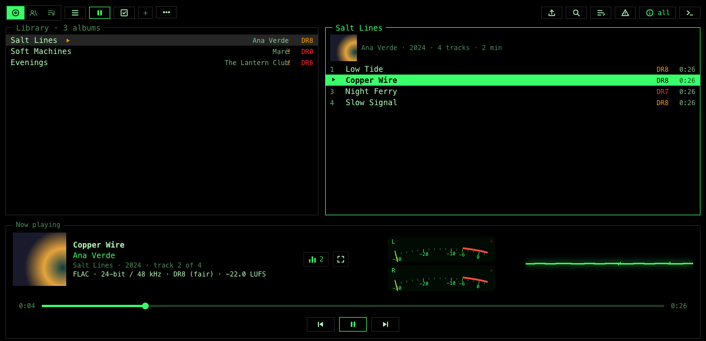
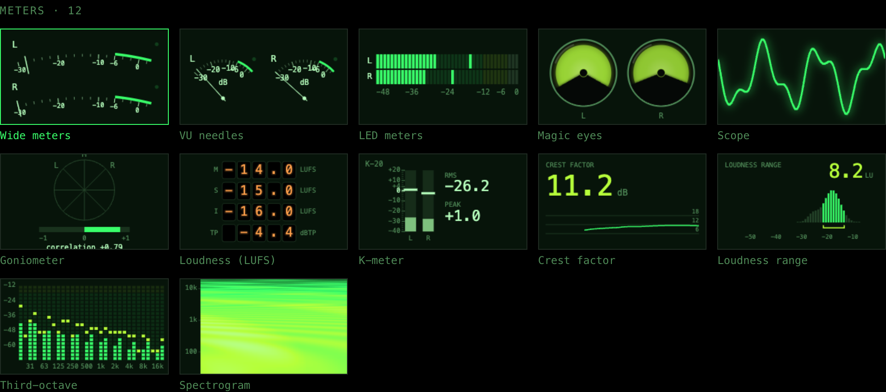
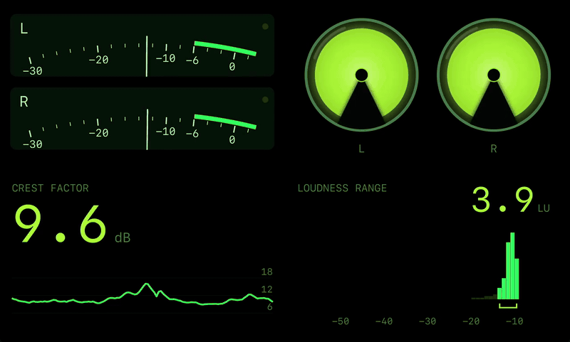
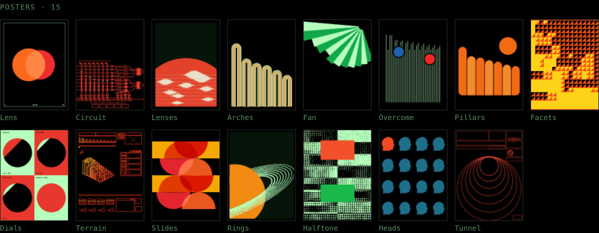
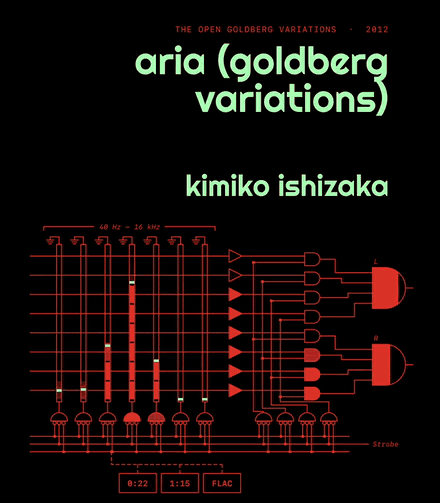
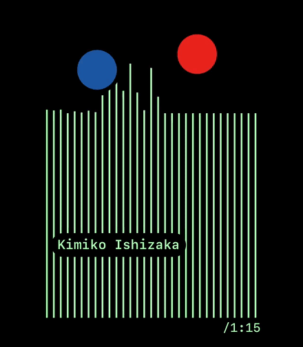
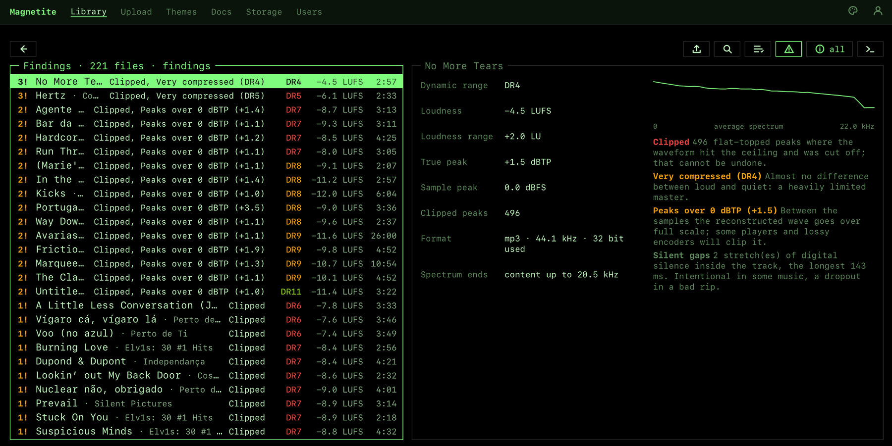

# Magnetite

Magnetite is a self-hosted music player. Its meters show loudness (LUFS), true peak and phase, and an analysis of the files flags the ones that are clipped, probably upsampled or from a lossy source. It runs in one Docker container.

Site and demo: [magnetite.stackcare.pt](https://magnetite.stackcare.pt). A library can be a folder on the server or a folder in [Ferrite](https://github.com/zhoorta/ferrite), a file server by the same author.

## Meters and posters

Up to four meters show at once, next to the player or in full screen. Every one is drawn from the audio that is playing. Loudness, true peak, phase correlation and the goniometer are computed sample by sample in an AudioWorklet, following ITU-R BS.1770; the file analysis uses the same code, so the live reading and the stored numbers agree. The meters are the user's own choice, saved in the account, and follow the colours of the theme.

Full screen (`F`) gives the meters the whole window; four panels share it and the controls hide after three seconds:

Posters are meters drawn like printed posters: flat shapes in a few colours, with the artist, title and album of the playing track printed on them, moving with the music. Arches, Fan and Pillars grow with the energy of each frequency range, Lens shows the two channels as two discs that overlap as they become alike, and Halftone and Facets scroll like a spectrogram.

Posters are upright, so two sit side by side in full screen. Circuit (left) fills its straps with seven frequency ranges; Overcome (right) draws one line per third-octave band, with two circles on the left and right peaks:

  
  

## File analysis

`magnetite:analyze` decodes each file once and measures dynamic range, integrated loudness, loudness range, true peak, clipped peaks, the bit depth in use, the average spectrum and an audio hash. From these it reports findings:

- probable lossy sources and probable upsampling, from where the spectrum ends;
- padded bit depth, clipping, very compressed masters, peaks over 0 dBTP, DC offset, decode errors;
- exact duplicates, whatever the tags say, and other copies of the same recording.

The truth view lists every analysed file in one table, worst first, with the findings of the selected file explained underneath, and the player bar shows the format, dynamic range and loudness of the playing track. The analysis is its own step after a scan, runs on the server and never changes the files. The thresholds, and where they can be wrong, are in [docs/guide/file-analysis.md](docs/guide/file-analysis.md).

## Library

- Two panes, a command line, an edit table and search with filters, built for the keyboard. Every key also has a button for touch.
- Untagged albums get suggested names from the folder and file names, MusicBrainz and, with an AcoustID key, audio fingerprints. Only fingerprints are sent, never audio.
- Each person has their own library and can share albums, tracks and playlists, play only. Zips of audio and covers can be uploaded; nothing is overwritten.
- The player keeps playing across page changes. The queue and position are restored, paused, after a reload.
- Files are served only through `/stream`, with a type allowlist and strict headers. ALAC is converted to FLAC and cached.

## Themes

A theme is a JSON file: six colours, a corner radius and fonts. It is small enough to paste into a chat. The studio edits a copy with a live preview, and themes are exported and imported as JSON. Sixteen open fonts are bundled.

## Clients

One server, four clients. They share the library, the shared music, the playlists and the list of meters saved in the account.

| Client | What it is |
|---|---|
| Web | The full app: library, player, theme studio, all meters and posters |
| Terminal (`tui/`) | Rust. Decodes the audio itself and computes the meters from the samples. Truth table, search, loudness matching, A/B compare |
| Android (`android/`) | Phone, tablet and Android TV. Twelve meters, posters, lock-screen controls. APK, not on the Play Store |
| iOS (`ios/`) | SwiftUI, iPhone and iPad. Nine of the twelve meters, background playback. Built with Xcode |

Binaries of the terminal client and the signed Android APK are attached to each [release](https://github.com/zhoorta/magnetite/releases).

## Install

With Docker, one command and nothing to configure (the image is built for amd64 and arm64):

    docker run -d --name magnetite -p 8080:8080 -v magnetite-data:/data -v magnetite-music:/music \
      -e MAGNETITE_USER=me -e MAGNETITE_PASSWORD=change-me ghcr.io/zhoorta/magnetite

Open `http://localhost:8080` and sign in. The two volumes keep the database and the music; to use a folder that already has music, put its path in place of `magnetite-music`. Leave the two `MAGNETITE_` settings out and the first visitor creates the administrator in the browser. The music folder must be writable by uid 33 for uploads (the start-up log warns when it is not).

Or build it yourself with Compose:

    MAGNETITE_USER=yourname docker compose up -d --build
    docker compose logs app | grep Password       # the first user's password, printed once

Then open `http://localhost:8080`. `docs/docker.md` has the music folder, a chosen password, a reverse proxy and updating.

Without Docker, with PHP and Node:

Needs PHP 8.3 or newer with Composer. ffmpeg is needed for ALAC and for the file analysis.

    composer setup                                # dependencies, .env, the SQLite file, migrations, assets
    php artisan magnetite:user yourname           # asks for a password
    mkdir -p storage/app/music/users/yourname     # put the music here, or set MAGNETITE_MUSIC_PATH in .env
    php artisan magnetite:scan yourname           # reads the files
    php artisan magnetite:analyze                 # optional: dynamic range, loudness and findings for every file
    composer dev                                  # web server, queue worker and Vite

Open the address the server prints (`http://127.0.0.1:8000`, or the next free port) and sign in. A queue worker has to be running for scans started from the web; `composer dev` starts one. In a library with no music yet, the Upload page takes zips and has a "Scan now" button for files copied in by hand.

To deploy: `docs/docker.md` (one image, web server and worker in one container) or `docs/bare-metal.md` (nginx, PHP-FPM, systemd, as the demo server runs).

## Documentation

The user guide is in [docs/guide](docs/guide/README.md) and on the site at [/docs](https://magnetite.stackcare.pt/docs): install, first run, library, meters, file analysis, themes, sharing, clients and configuration. The design notes are in [docs](docs/README.md).

## Develop

    vendor/bin/pest            # PHP tests
    npm run test:js            # the meters, the library's row model and keys
    vendor/bin/pint --test     # style

`PLAN.md` has the status and what is open, `docs/README.md` indexes the topic docs, and `CLAUDE.md` holds the conventions that matter when changing the code (the persistent player, the visualizer contract, the streaming rules).

## License

Magnetite is free software, licensed under the [GNU Affero General Public License v3.0 or later](LICENSE) (AGPL-3.0-or-later). A modified version run as a network service must offer its source to the users of that service. The whole repository is under that one licence: the server, the web app, the terminal client (`tui/`), the Android app (`android/`) and the iOS app (`ios/`).
