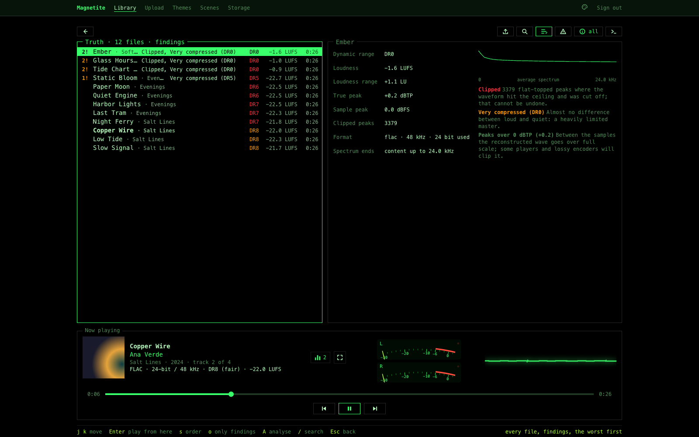

# Magnetite

Magnetite is a self-hosted music player for the browser. It plays the files stored on the server it is installed on, shows loudness meters, analyses every file, and restyles the whole interface from a small JSON theme. A personal project by the author of Ferrite.

## What it does

- The player keeps playing across page changes; the audio element and the Web Audio graph are not recreated.
- Nine meters, up to four at once. LUFS (momentary, short-term, integrated), true peak, phase correlation and a goniometer are computed sample by sample in an AudioWorklet.
- `magnetite:analyze` decodes every file and reports lossy sources, upsampling, clipping, heavy compression, true peak over 0 dBTP and duplicates, with the dynamic range of each track and album.
- The library is built for the keyboard: two panes, a command line, an edit table, search with filters and a truth view. Every key also has a button for touch.
- A theme is one JSON file with the palette, corner radius, font and settings for each meter. The theme studio previews it live and there are 16 bundled open fonts.
- Each person has their own library and can share albums, tracks and playlists. Zips of audio and covers can be uploaded. Files can also live in a Ferrite folder.
- Clients: the web app, a terminal client (`tui/`, Rust), Android for phone, tablet and TV (`android/`) and iOS (`ios/`).

## Run it

Needs PHP 8.3 or newer with Composer, and Node. ffmpeg is needed for ALAC and for the file analysis.

    composer setup                                # dependencies, .env, the SQLite file, migrations, assets
    php artisan magnetite:user yourname           # asks for a password
    mkdir -p storage/app/music/users/yourname     # put the music here, or set MAGNETITE_MUSIC_PATH in .env
    php artisan magnetite:scan yourname           # reads the files
    php artisan magnetite:analyze                 # optional: dynamic range, loudness and findings for every file
    composer dev                                  # web server, queue worker and Vite

Open the address the server prints (`http://127.0.0.1:8000`, or the next free port) and sign in. A queue worker has to be running for scans started from the web; `composer dev` starts one. In a library with no music yet, the Upload page takes zips and has a "Scan now" button for files copied in by hand.

With Docker instead (one container, nothing to configure):

    MAGNETITE_USER=yourname docker compose up -d --build
    docker compose logs app | grep Password       # the first user's password, printed once

Then open `http://localhost:8080`. `docs/docker.md` has the music folder, a chosen password, a reverse proxy and updating.

To deploy: `docs/docker.md` (one image, web server and worker in one container) or `docs/bare-metal.md` (nginx, PHP-FPM, systemd, as magnetite.stackcare.pt runs).

## Develop

    vendor/bin/pest            # PHP tests
    npm run test:js            # the meters, the library's row model and keys
    vendor/bin/pint --test     # style

`PLAN.md` has the status and what is open, `docs/README.md` indexes the topic docs, and `CLAUDE.md` holds the conventions that matter when changing the code (the persistent player, the visualizer contract, the streaming rules).

## License

Magnetite is free software, licensed under the [GNU Affero General Public License v3.0 or later](LICENSE) (AGPL-3.0-or-later). A modified version run as a network service must offer its source to the users of that service. The whole repository is under that one licence: the server, the web app, the terminal client (`tui/`), the Android app (`android/`) and the iOS app (`ios/`).
