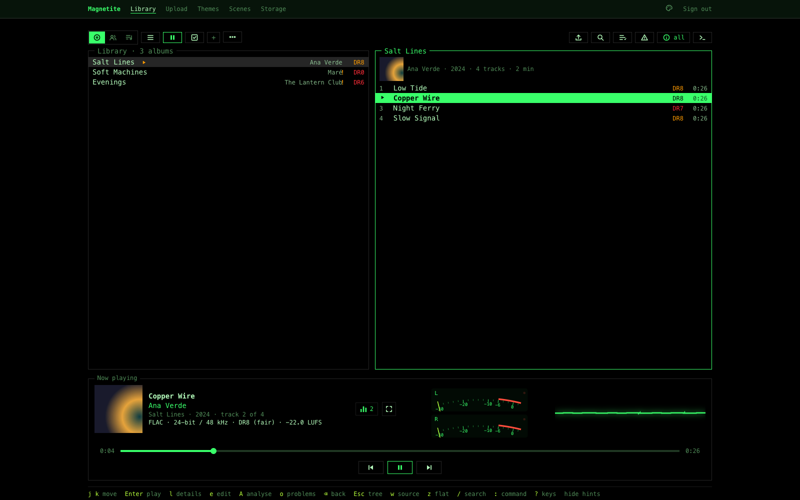

# Magnetite

A music player for your own server where the look is the product: a persistent player, live meters that measure properly, a keyboard-first library, and themes that are one small JSON file. A personal project by the maker of Ferrite.

## What it does

- **Never stops playing.** The audio element and the Web Audio graph survive navigation.
- **Meters that measure.** LUFS (momentary, short-term, integrated), true peak, phase correlation and a goniometer, computed sample by sample in an AudioWorklet; nine meters, up to four at once.
- **File truth.** `magnetite:analyze` decodes every file and says what it really is: lossy source, upsampled, clipped, very compressed, over 0 dBTP, duplicates; dynamic range per track and album.
- **A library for the keyboard.** Two panes, a command line, an edit table, search with filters, a truth view. Everything also has a button for touch.
- **Themes as bundles.** Palette, radius, font and a look for each meter in one JSON file, with 16 bundled open fonts to choose from; a theme studio with a live preview; pictures can drive a meter too (scenes).
- **Your own libraries.** Each person has their own folder, can share albums, tracks and playlists, and uploads zips of audio and covers. Files can also live in a Ferrite folder.
- **Four clients on one server:** the web app, a terminal client (`tui/`, Rust), Android phone, tablet and TV (`android/`) and iOS (`ios/`).

## Run it

Laravel 13, Livewire 4, Alpine, Tailwind 4, Vite, PHP 8.3 or newer; ffmpeg and Node for ALAC and the analysis.

    composer install && npm install && npm run build
    cp .env.example .env && php artisan key:generate
    php artisan migrate
    php artisan magnetite:user yourname          # asks for a password
    # put music in storage/app/music/users/yourname, or set MAGNETITE_MUSIC_PATH
    composer dev                                  # server, queue worker and Vite

Then sign in at `http://localhost:8000`, run a scan from the library (`magnetite:scan yourname` does it from the command line) and `magnetite:analyze` for the file truth. A queue worker has to be running for scans started from the web.

To deploy: `docs/docker.md` (one image, web and worker) or `docs/bare-metal.md` (nginx, PHP-FPM, systemd, as magnetite.stackcare.pt runs).

## Develop

    vendor/bin/pest            # PHP tests
    npm run test:js            # the meters, the library's row model and keys
    vendor/bin/pint --test     # style

`PLAN.md` has the status and what is open, `docs/README.md` indexes the topic docs, and `CLAUDE.md` holds the conventions that matter when changing the code (the persistent player, the visualizer contract, the streaming rules).

## License

Magnetite is free software, licensed under the [GNU Affero General Public License v3.0 or later](LICENSE) (AGPL-3.0-or-later). If you run a modified version as a network service, you must offer its source to the users of that service. The whole repository is under that one licence: the server, the web app, the terminal client (`tui/`), the Android app (`android/`) and the iOS app (`ios/`).
